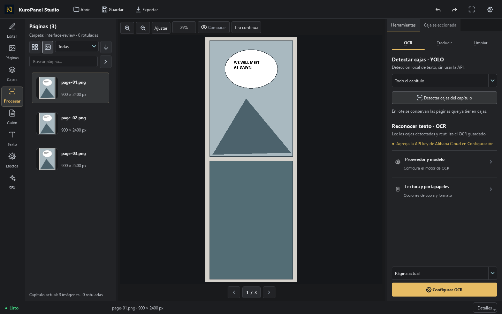
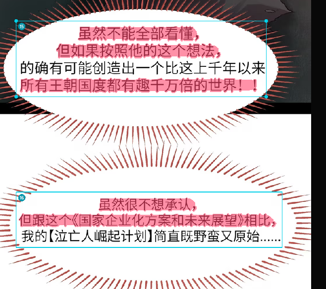
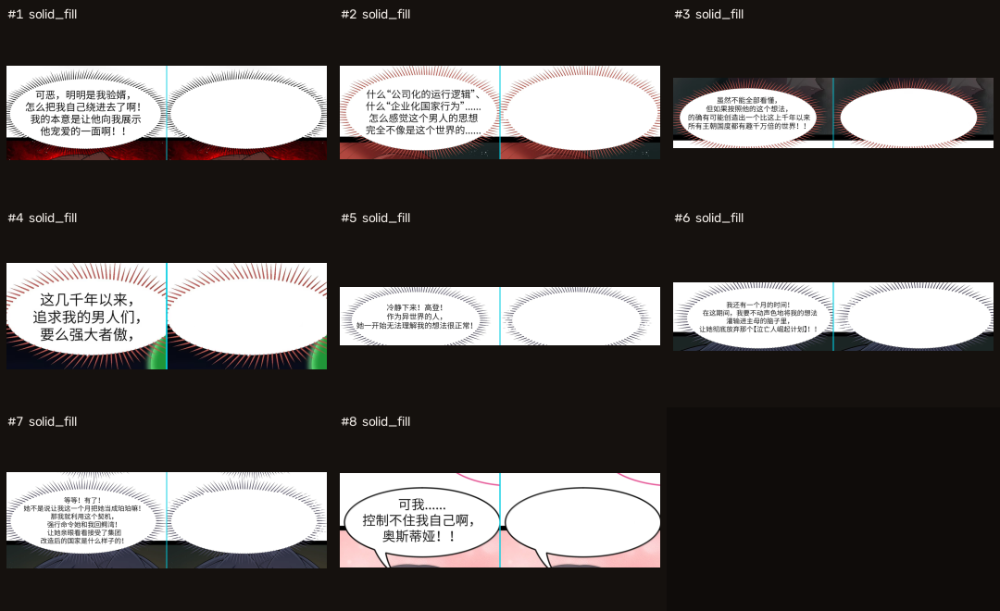
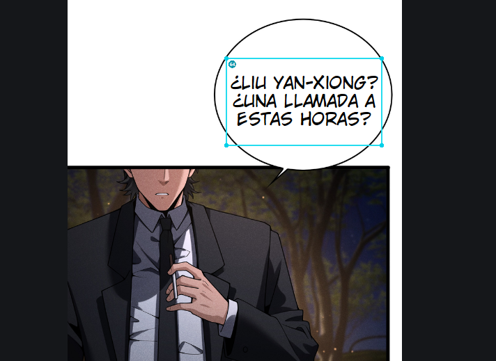
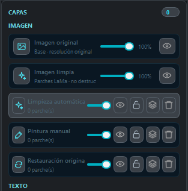

# KuroPanel Studio

Editor de escritorio para OCR, traducción, limpieza y typpeo de manhua, manhwa
y manga. Está construido con Python, PySide6, OpenCV y ONNX Runtime.

**Versión 0.2.25** corrige el bloqueo al abrir páginas después del OCR: el texto de los globos grandes se coloca de 3 a 5 veces más rápido, con el mismo resultado.

[Descargar instalador para Windows x64](https://github.com/JipsonDev/KuroPanelStudio/releases/download/v0.2.25/KuroPanelStudio-Setup-0.2.25-Windows-x64.exe)
· [Última versión](https://github.com/JipsonDev/KuroPanelStudio/releases/latest)
· [Historial de cambios](CHANGELOG.md)

El instalador incluye los modelos locales y funciona en CPU. No necesitas
instalar Python para utilizarlo. OCR y traducción mediante API requieren las
credenciales del proveedor que configures.

> [!WARNING]
> Este proyecto fue desarrollado en su mayoría con asistencia de inteligencia
> artificial, bajo dirección y pruebas humanas. Es software experimental y
> puede contener errores de funcionamiento, rendimiento, compatibilidad,
> seguridad o pérdida de trabajo. Conserva copias de las imágenes y proyectos
> originales, revisa siempre las máscaras y verifica cada exportación antes de
> usarla en producción.

KuroPanel Studio es un proyecto independiente. No está afiliado con otros
editores de manga/manhua ni con los proveedores de modelos o APIs compatibles.

## Capturas

### Interfaz principal



[Interfaz simplificada, ubicación de comandos y YOLO por capítulo](docs/interface-and-chapter-yolo.md).

La cabecera reúne las acciones de archivo y exportación. El lienzo conserva
zoom, comparación y navegación; **Caja seleccionada** concentra la edición de
texto. Los ajustes secundarios permanecen plegados para dejar más espacio al
capítulo.

| Tarea | Dónde encontrarla |
| --- | --- |
| Abrir carpeta, proyecto editable o PSD/PSB | **Abrir**, en la cabecera |
| Guardar el proyecto `.mseproj` | **Guardar** o `Ctrl+S` |
| Detectar cajas, leer OCR, traducir y limpiar | **Procesar** |
| Corregir el texto de una caja | **Editar → Caja seleccionada** |
| Exportar página, capítulo o tira continua | **Exportar**, en la cabecera |
| Elegir PNG, JPG, WEBP o PSD para páginas | **Exportar → Formato de página** |
| Configurar el logo y su reparto | **Menú de aplicación → Marca de agua** |

### Detección y cajas OCR

Las cajas numeradas mantienen el orden de lectura y permiten ejecutar OCR,
traducción, limpieza y typpeo por región, página o capítulo.

Para detectar un capítulo completo:

1. Abre las imágenes y entra en **Procesar → OCR**.
2. En **Detectar cajas · YOLO**, selecciona **Todo el capítulo**.
3. Pulsa **Detectar cajas del capítulo** y revisa las regiones encontradas.

YOLO funciona localmente y no necesita una clave API. El lote procesa una
página a la vez, muestra progreso y permite cancelar. Conserva las páginas
que ya tienen cajas para proteger OCR, traducciones y ediciones; para volver
a detectar una página, elige **Página actual**. Cancelar o fallar no aplica
resultados parciales, y **Deshacer** revierte el lote completo.

Para mangas de derecha a izquierda, activa **Lectura manga · derecha →
izquierda** dentro de **Procesar → OCR → Lectura y portapapeles**. Se aplica
a todo el capítulo, renumera las cajas existentes y se guarda con el proyecto.



### Limpieza MI-GAN y LaMa no destructiva

Comparación de varios globos antes y después del proceso. La máscara de texto y
los parches de limpieza se conservan separados de la imagen original.

MI-GAN es el motor predeterminado para instalaciones nuevas. Puedes elegir
MI-GAN o LaMa en **Limpiar página → Motor de limpieza → Modelo local**.
Las preferencias guardadas se conservan al actualizar. Los globos de color
uniforme siguen usando el relleno protegido de sus letras, sin ejecutar una
red de reconstrucción. [Integración y rendimiento de MI-GAN](docs/migan-cleaning.md).

Las selecciones grandes se limpian mediante recortes a resolución original,
con un límite espacial por inferencia. [Detalles y verificación](docs/cleaning-native-tiles.md).



### Typpeo y traducción



### Capas de retoque



### Tira continua

**Tira continua** permite recorrer el capítulo y mover sus marcas de agua sin
unir las imágenes en memoria. Doble clic abre una página para editarla.
La vista adapta el detalle al zoom y a la densidad de pantalla.
**Exportar → Tira continua en PNG…** guarda todo a resolución original,
página a página, incluyendo textos, retoques y marcas de agua.
[Uso, límites y pruebas de rendimiento](docs/continuous-strip.md).

### Marcas de agua

El ajuste equilibrado para configuraciones nuevas usa **22 % del ancho de
página**, **55 % de opacidad**, lados alternados, unos **7.000 px entre
centros** y un máximo de **24 marcas automáticas en todo el capítulo**.
En capítulos largos, el límite aumenta la distancia para evitar acumulación.

Puedes arrastrar las marcas en el lienzo o en la tira; sus posiciones se
guardan por página y se conservan al exportar. **Usar ajuste equilibrado**
conserva el PNG y reemplaza las posiciones manuales para rehacer el reparto.
Los proyectos existentes mantienen su configuración hasta elegir ese ajuste.
[Distribución y tamaño del logo](docs/watermark-distribution.md).

Las imágenes mostradas son material de prueba. Antes de reutilizar capturas o
páginas en publicaciones públicas, confirma que tienes los derechos necesarios.

## Funciones principales

- Detección local de texto con YOLO por página o capítulo, compatible con páginas largas.
- OCR por caja, página o capítulo mediante proveedores configurables.
- Traducción con glosarios y contexto por proyecto.
- Limpieza con máscara OCR y MI-GAN o LaMa ONNX, con respaldo CPU o aceleración CUDA.
- Previsualización de máscara y corrección manual de falsos positivos.
- Pinceles de pintura, máscara y restauración del original.
- Capas no destructivas con visibilidad, opacidad y bloqueo independientes.
- Typpeo con perfiles de fuente, estilos, trazo, degradado y resplandor.
- Herramientas SFX con perspectiva, curvas y deformación.
- Orden de lectura occidental o manga de derecha a izquierda.
- Importación de PNG, JPEG, WebP, PSD y PSB.
- Proyectos persistentes `.mseproj`, autoguardado y copias incrementales.
- Vista de tira continua con carga de teselas y caché limitada.
- Marcas de agua movibles y reparto continuo con límite por capítulo.
- Exportación por página, capítulo o tira única en PNG a resolución original.
- Comparación antes/después con divisor arrastrable.
- Monitor de RAM, VRAM y tiempos de procesamiento.
- Interfaz en español o inglés, seleccionable en **Configuración → Interfaz**.

El idioma de la interfaz se aplica al guardar la configuración y se conserva al
reiniciar. Es independiente de los idiomas de origen y destino del OCR y la
traducción.

## Requisitos

- Windows 10 u 11 de 64 bits.
- Python 3.11 o posterior para ejecutar desde el código fuente. La versión de
  desarrollo actual se prueba con Python 3.14.
- 8 GB de RAM como mínimo; 16 GB o más son recomendables para tiras largas.
- Aproximadamente 4 GB libres para entorno, modelos y cachés.
- GPU NVIDIA opcional. El modo CPU continúa disponible sin CUDA.
- Git LFS para descargar los modelos almacenados en el repositorio.

## Instalación en Windows con el instalador `.exe` (recomendada)

Si solo quieres utilizar KuroPanel Studio, no necesitas instalar Python, Git ni
descargar el código fuente:

1. Abre la sección de [Releases](https://github.com/JipsonDev/KuroPanelStudio/releases).
2. En la versión más reciente, descarga
   `KuroPanelStudio-Setup-<versión>-Windows-x64.exe`.
3. Ejecuta el instalador y, si lo deseas, activa el acceso directo del
   escritorio.
4. Abre **KuroPanel Studio** desde el menú Inicio o desde el acceso directo.

La aplicación instalada busca actualizaciones al iniciar (se puede desactivar
en **Configuración → Interfaz**) y permite buscarlas desde el menú superior.
Si hay una versión nueva en GitHub Releases, descarga el instalador, verifica
su SHA-256 y lo aplica al cerrar la sesión actual. Los usuarios ya instalados
no tienen que descargar manualmente cada `.exe`.

El instalador funciona en Windows x64, se instala en la carpeta del usuario y
no necesita permisos de administrador. Incluye la aplicación, los modelos y las
dependencias de ejecución. Las credenciales de las API no están incluidas: cada
usuario debe configurarlas dentro del programa.

Windows puede mostrar una advertencia de SmartScreen porque esta versión aún
no tiene firma digital. Verifica la descarga comparando su SHA-256 con el
archivo `SHA256SUMS.txt` incluido en la misma Release.

## Instalación desde el código fuente

Instala Git LFS antes de clonar, porque los modelos ONNX no caben en el flujo
normal de Git:

```powershell
git lfs install
git clone https://github.com/JipsonDev/KuroPanelStudio.git
cd KuroPanelStudio
git lfs pull

py -3.14 -m venv .venv
.\.venv\Scripts\Activate.ps1
python -m pip install --upgrade pip
pip install -r requirements.txt
python main.py
```

Para NVIDIA, usa un entorno limpio e instala la variante GPU:

```powershell
py -3.14 -m venv .venv-gpu
.\.venv-gpu\Scripts\Activate.ps1
python -m pip install --upgrade pip
pip install -r requirements-gpu.txt
python main.py
```

La compatibilidad CUDA depende de que las versiones de ONNX Runtime, CUDA y
cuDNN sean compatibles entre sí. Si la inicialización CUDA falla, selecciona
CPU o Automático desde Configuración.

## Modelos

La carpeta `Models/` debe contener:

- `migan_pipeline_v2.onnx`: motor MI-GAN de reconstrucción, predeterminado para instalaciones nuevas.
- `lama.onnx`: reconstrucción de las zonas enmascaradas.
- `ocr.onnx`: generación de la máscara local de texto para limpieza.
- `yolo12s_animetext.onnx`: detector de regiones de texto.
- `yolo12s_1class.yaml`: metadatos del detector.
- `yolo12s_animetext.pt`: respaldo opcional para desarrollo.

Los archivos `*.onnx`, `*.pt` y `*.safetensors` están configurados mediante
Git LFS en `.gitattributes`.

## Flujo recomendado

1. Abre una carpeta de imágenes, un proyecto editable o un PSD/PSB.
2. En **Procesar → OCR**, detecta cajas con YOLO en la página o en todo el capítulo.
3. Configura **Proveedor y modelo** de OCR y reconoce el texto pendiente.
4. En **Procesar → Limpiar**, prepara la máscara, corrige falsos positivos y
   aplica la limpieza con MI-GAN o LaMa. La limpieza por capítulo es automática.
5. Traduce utilizando el glosario del proyecto y revisa el texto de cada caja.
6. Aplica perfiles tipográficos y ajusta las marcas de agua si las necesitas.
7. Guarda el proyecto, compara original/resultado y elige el alcance desde **Exportar**.

## Credenciales y privacidad

Las claves de Alibaba, Gemini, DeepSeek y otros proveedores se introducen desde
Configuración. En Windows se guardan cifradas para el usuario actual mediante
DPAPI. `api_configs.json`, `credentials.dat`, entornos virtuales, compilaciones
y datos temporales no deben publicarse.

La aplicación puede enviar recortes de las cajas a las APIs elegidas por el
usuario. Revisa las políticas de privacidad de cada proveedor antes de procesar
contenido confidencial.

## Proyectos, capas y exportación

- Los archivos `.mseproj` guardan cajas, OCR, traducciones, estilos y parches.
- La imagen original se conserva como base de solo lectura.
- La limpieza MI-GAN/LaMa, pintura y restauración se almacenan como parches independientes.
- `Ctrl+S` guarda; `Ctrl+Z` deshace; `Ctrl+Y` o `Ctrl+Shift+Z` rehace.
- La exportación no incluye cajas, numerales ni controles del lienzo.

## Pruebas

Consulta las [mejoras de procesamiento y sus mediciones](docs/processing-performance.md)
para reproducir el benchmark local de detección y OCR sin enviar imágenes a una API.
También se documentan las [correcciones de limpieza y detección de globos](docs/balloon-cleaning.md).
Consulta las [correcciones de errores OCR y el progreso visible](docs/ocr-errors-progress.md)
para configurar la región y distinguir problemas de modelo, clave o cuota.
El [control de consumo OCR](docs/ocr-cost-control.md) explica la caché persistente,
la relectura explícita y el contador de solicitudes y tokens.
Consulta la [interfaz simplificada y YOLO por capítulo](docs/interface-and-chapter-yolo.md)
para conocer los comandos actuales, el comportamiento del lote y las capturas de verificación.
La [limpieza por regiones de color](docs/bubble-mask-cleaning.md) explica la
adaptación de `Bubble_Mask.atn`, la corrección de letras recortadas y sus pruebas.
La [distribución de marcas de agua](docs/watermark-distribution.md) permite
medir el logo visible, conservar su tamaño entre cortes de página, adaptar la
ubicación al espacio libre y controlar la distancia y separación del capítulo.

```powershell
pip install pytest
python -m pytest -q
```

Las pruebas automatizadas reducen regresiones, pero no garantizan que todas las
páginas, fuentes, GPUs, idiomas o estilos de globo funcionen correctamente.
Reporta los fallos incluyendo sistema operativo, hardware, pasos y una muestra
que puedas compartir legalmente.

## Compilar para Windows

La aplicación instalable se construye con:

```powershell
.\build_windows.ps1 -Version 0.2.25
```

La edición compacta CPU-first se construye con:

```powershell
.\build_windows_compact.ps1
```

Para crear el instalador x64 con Inno Setup 6:

```powershell
.\build_installer.ps1 -Version 0.2.25
```

El instalador para GitHub se genera en `github-release/KuroPanelStudio-v0.2.25/`.
Usa `-LocalOnly` en ambos comandos para generar un instalador local registrado en
`local-builds/KuroPanelStudio-v0.2.25/`.
En GitHub, una etiqueta `vX.Y.Z` inicia el flujo de Windows que compila,
prueba y adjunta el instalador y las notas de cambios a la Release sin subirlos manualmente.
Consulta [la guía de publicación](docs/actualizaciones.md).

## Estructura

```text
core/        lógica de OCR, detección, limpieza, proyectos y rendimiento
ui/          ventanas, paneles, lienzo y herramientas
scripts/     integración y utilidades para Photoshop/pruebas
tests/       pruebas automatizadas
Models/      modelos locales administrados con Git LFS
assets/      iconos, estilos y metadatos de Windows
docs/images/ capturas usadas por este README
installer/   configuración reproducible de Inno Setup
```

## Contribuciones

Se aceptan reportes y mejoras, pero revisa cuidadosamente el código generado o
modificado con IA. Una contribución debe explicar qué cambia, cómo fue probada
y qué riesgos conocidos conserva. No incluyas claves API, material con derechos
de terceros ni archivos personales.

## Licencia

La licencia pública todavía debe ser elegida por el propietario antes de abrir
el repositorio. Hasta que exista un archivo `LICENSE`, el código conserva los
derechos predeterminados de autor y no se concede automáticamente permiso para
redistribuirlo o modificarlo.
