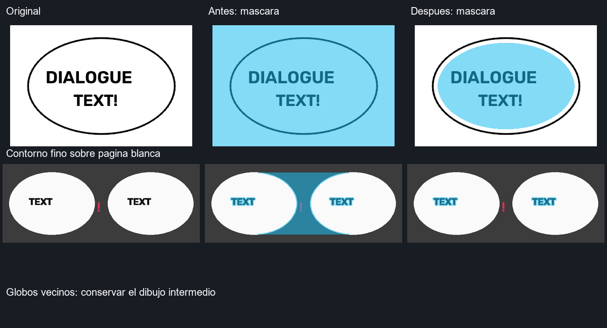

# Limpieza y detección de globos

## Correcciones

- Se identifica el interior de contornos cerrados antes de ajustar texto.
  Los bordes finos no se unen al fondo blanco de la página. Los huecos que
  dejan las letras se recuperan como espacio disponible para tipografía.
- Las líneas de texto con hasta 40 píxeles de separación vertical pueden
  agruparse cuando pertenecen al mismo globo cerrado. Dos contornos distintos
  impiden esa unión. Si falta evidencia del contorno, se conserva la regla
  anterior de proximidad de cinco píxeles.
- Una caja YOLO que ocupa más del 15 % de una imagen recortada puede conservarse
  si su texto está contenido en un globo. Antes se descartaba incondicionalmente.
- La máscara de limpieza reconstruye cada componente de fondo por separado
  y respeta su silueta, incluidas concavidades. Ya no forma un único contorno
  convexo que atraviesa el dibujo situado entre dos globos.
- Al combinar parches, solo se copian los píxeles incluidos en cada máscara.
  Un parche solapado ya no restaura accidentalmente el texto borrado por otro.
- La versión de caché de máscaras cambia para recalcular los resultados.

## Validación

Se añadieron 14 casos de regresión para contornos finos y pequeñas aperturas,
fondos blancos, coloreados y oscuros, cajas grandes, líneas espaciadas, globos
vecinos, siluetas cóncavas y parches solapados. Se prueba además el flujo completo
de preparación y limpieza de una página con dos globos.
La suite completa actual finaliza con **395 pruebas y 8 subtests aprobados**.

Comparación sintética contra el código original de `origin/main`
(`c82693de74ebd12e1172ae582abddf30a77a60fd`):

| Caso | Antes | Después |
| --- | ---: | ---: |
| Píxeles del área tipográfica fuera del globo de borde fino | 42 807 | 0 |
| Píxeles de limpieza fuera de dos globos vecinos | 17 631 | 0 |
| Píxeles de letras incluidos en la máscara de los globos vecinos | — | 100 % |
| Cajas conservadas en un globo recortado, YOLO ONNX real en CPU | 0 | 1 |



El cian representa el área tipográfica en la primera fila y la máscara que se
limpia en la segunda. La imagen de prueba se genera con formas y letras
sintéticas; no es una muestra de manga real ni una evaluación general de
precisión. Los pesos de YOLO, OCR y LaMa no se modificaron. La validación
posterior con cinco páginas aportadas por el usuario, siete globos anotados y
comparaciones visuales por globo se describe en
[validacion-limpieza-real.md](validacion-limpieza-real.md).

La validación con ONNX usa `Models/yolo12s_animetext.onnx` y ejecución CPU.
La limpieza entre globos se verifica con el relleno sólido real del programa;
esa muestra no necesita LaMa. Los contornos abiertos o muy degradados siguen
dependiendo de las heurísticas de respaldo y pueden requerir corrección manual.

```powershell
.\.venv\Scripts\python.exe -m pytest tests/test_balloon_cleaning.py -q
.\.venv\Scripts\python.exe -m pytest -q
```


## Recuperación de globos y tinta (8 de octubre de 2026)

Se buscan fondos planos dentro de contornos cerrados con varios componentes
compatibles con letras. Si las cajas iniciales no cubren su tinta, YOLO vuelve
a revisar solo ese globo a mayor escala, con confianza 0,18 como máximo. Estas
propuestas geométricas nunca se aceptan como texto sin una predicción de YOLO.
La pasada adicional es local y no consume tokens de ninguna API.

Los bloques grandes sin contorno cerrado pueden conservarse cuando su confianza
es al menos 0,65, ocupan como máximo el 45 % de la imagen y contienen tres líneas
independientes alineadas, próximas y sobre fondo mayormente uniforme. En el
recorte real `179-02-dialogo-grueso`, el marcado pasó de tres líneas a un bloque
que incluye las cuatro. La cobertura del rectángulo de selección anotado pasó
de 31,9 % a 95,7 %; cada rectángulo de línea queda cubierto al menos en 98 %.
Esto mide cobertura geométrica, no exactitud del OCR remoto. Los otros cuatro
recortes mantuvieron sus cajas. La búsqueda añade trabajo CPU; en esa ejecución
local los recortes completos tardaron entre 0,14 y 0,36 segundos.

La terminación de fragmentos usa contraste RGB respecto al fondo dominante,
en lugar de exigir tinta negra sobre blanco. Admite restos grises, coloreados y
texto claro sobre fondo oscuro, siempre que al menos el 85 % del mismo carácter
ya esté enmascarado, falte una fracción pequeña y el componente esté dentro de la
selección. Los fondos texturados, líneas largas y marcas aisladas se excluyen.
La versión de máscaras cambia a 43 para recalcular las máscaras anteriores.

## Halos de compresión y protección del dibujo (11 de octubre de 2026)

La máscara también completa pequeños componentes de bajo contraste situados a
un máximo de seis píxeles de tinta ya confirmada. El fondo se estima excluyendo
el texto enmascarado: una caja con mucho texto no debe confundir sus letras con
el color de fondo. Se exige que al menos el 68 % de las muestras de fondo estén
a tres niveles RGB del color dominante. Los degradados y tramas no cumplen esa
condición y mantienen el procesamiento neuronal.

Solo se añaden componentes pequeños, enteramente dentro del margen seguro de la
selección. Se rechazan líneas largas y fragmentos próximos a dibujo de alto
contraste no aprobado. No se difumina la imagen ni se rellena todo el rectángulo.
La versión de caché pasa a **44**; la máscara ampliada puede revisarse antes de
limpiar. La corrección de degradados después de LaMa exige ahora apoyo del 90 %
del anillo de contexto para evitar aplanar una ilustración que cruza el texto.

Se revisaron cinco recortes reales y siete zonas. En la subzona blanca anotada
de `156-01-dialogo-mixto` (`x=90, y=4790, ancho=335, alto=108` en la página),
los píxeles con contraste mayor de tres niveles respecto al blanco pasaron de
**87 a 0** frente a `04a83d1`. Las siete zonas mantienen cero residuos oscuros
(criterio anterior: mínimo RGB menor de 80). No hubo cambios fuera de la unión
de selecciones y rectángulos de texto; sí hubo 571 píxeles modificados fuera de
los rectángulos estrictos de texto, incluidos dos originalmente oscuros, frente
a 569 y dos en la revisión anterior. Los rectángulos no son máscaras exactas de
las letras ni prueban ausencia de daño dentro de ellos.

La revisión visual todavía muestra irregularidades en el borde gris de la
viñeta que atraviesa el primer globo. Los globos translúcidos y el texto sobre
dibujos siguen requiriendo revisión: estos resultados no garantizan limpieza
perfecta en cualquier capítulo. Los originales y resultados se mantienen en
`graphify-out/real-cleaning/soft-halos-v12-final/`, fuera de Git.

### Herramientas revisadas

Se aplicaron los skills de morfología, preprocesamiento y umbrales de
[image-processing-skills](https://github.com/aeren23/image-processing-skills).
Se revisaron [PanelCleaner](https://github.com/VoxelCubes/PanelCleaner),
[Manga Cleaner Studio](https://github.com/BulganRdn/manga-text-cleaner) y
[LaMa](https://github.com/advimman/lama) para contrastar la separación entre
máscara, relleno plano y reconstrucción. Esta mejora tiene implementación propia;
no incorpora código de esos proyectos ni nuevas dependencias.

El `models/lama.onnx` existente coincide por SHA-256 con
[lama-manga-onnx-dynamic](https://huggingface.co/ogkalu/lama-manga-onnx-dynamic),
exportación de [AnimeMangaInpainting](https://huggingface.co/dreMaz/AnimeMangaInpainting).
El exportador declara Apache-2.0 y el modelo original MIT en sus fichas. Huella:
`de31ffa5ba26916b8ea35319f6c12151ff9654d4261bccf0583a69bb095315f9`.
No se cambiaron ni descargaron pesos adicionales. La limpieza sigue siendo
local y no utiliza tokens ni créditos de Alibaba u otra API.
