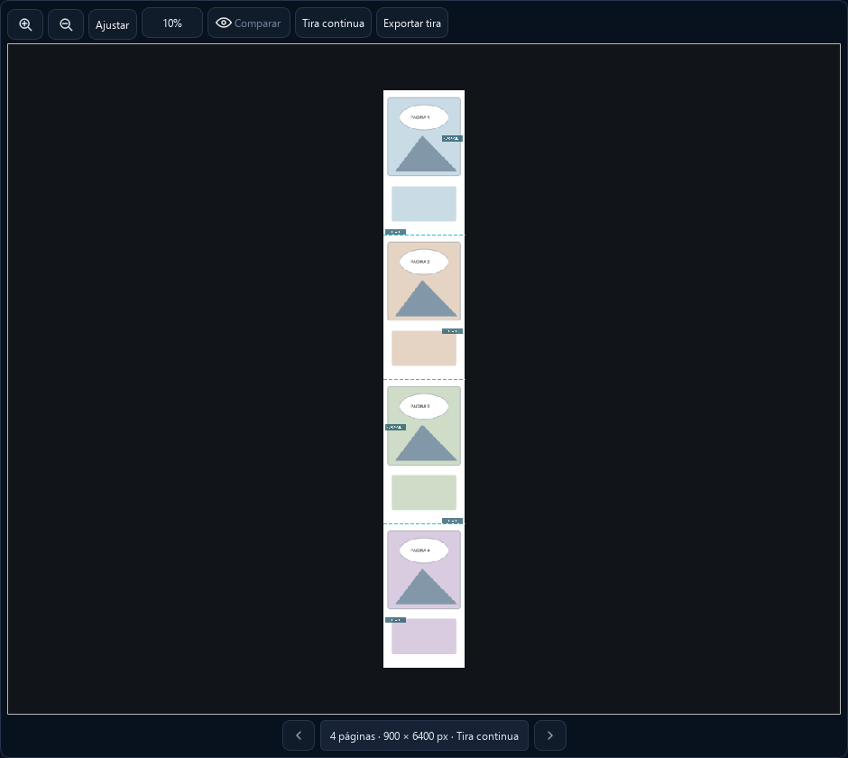

# Tira continua y exportación a un PNG

Pulsa **Tira continua** sobre el lienzo para recorrer todas las páginas del
capítulo sin unir los archivos originales. La rueda desplaza la vista;
Ctrl + rueda cambia el zoom; **Ajustar** encaja el ancho. Los botones anterior
y siguiente y la lista de páginas navegan por la tira.

Puedes arrastrar las marcas de agua o borrarlas con Ctrl + clic o Supr.
Los controles de marca **Página actual** se refieren a la página visible en
el centro de la tira. Los movimientos conservan sus coordenadas por página
y se guardan, exportan y deshacen con el proyecto.

El editor indica cuántas posiciones manuales están guardadas. Estas se
respetan incluso si cambias la separación automática. Para recuperar un
reparto uniforme usa **Redistribuir todo el capítulo** en el editor de marcas.

**Usar ajuste equilibrado** conserva tu PNG y aplica el nuevo valor
predeterminado: ancho del 22 % de página, opacidad del 55 %, lados alternados,
unos 7.000 px entre centros y máximo de 24 marcas automáticas en todo el
capítulo. La separación mínima es de 2.500 px entre los bordes de las marcas;
el límite puede aumentar la distancia en capítulos largos. El botón también
reemplaza las posiciones manuales guardadas para rehacer el reparto completo.
Las configuraciones guardadas en proyectos se respetan hasta aplicar el ajuste.

El doble clic abre la página elegida para OCR, limpieza y edición de texto.
Las páginas siguen separadas en el proyecto: el modo de vista no fusiona las
cajas ni habilita selecciones de OCR que crucen dos archivos.

**Exportar tira** genera un solo PNG con las páginas en el orden del proyecto,
incluidos textos, retoques y marcas de agua. Conserva los píxeles originales;
si los anchos difieren, centra cada página sobre fondo blanco sin escalarla.
Los archivos nuevos se importan en orden natural: `1.png`, `2.png`, `10.png`.
Los proyectos existentes conservan el orden guardado.

## Memoria y cancelación

- La geometría usa tamaños y offsets, sin decodificar el capítulo.
- Al entrar en la tira se libera la imagen del lienzo individual que queda
  oculto y se invalidan sus cargas pendientes, evitando retener dos fondos.
- Solo se solicitan las teselas de la vista y un pequeño margen alrededor.
  Cada lote contiene hasta cuatro teselas 1024 × 2048; las vistas lejanas usan
  menos píxeles según el zoom y se descartan al alejarse.
- Los pixmaps tienen un presupuesto de 48 MiB. La caché de páginas compuestas
  usa 32 MiB o el tamaño RGB de la página más grande, lo que sea mayor. La
  decodificación temporal todavía necesita la memoria de una página fuente;
  archivos individuales muy grandes pueden superar el presupuesto habitual.
- La vista considera la densidad de pantalla y conserva los píxeles originales
  a aumentos habituales de lectura. Al alejar usa recortes con detalle adicional
  y reducción Lanczos. Si el área visible excede el presupuesto, baja el detalle
  para cubrirla completa antes de cargar el margen de desplazamiento. Al acercar
  recupera el original; la resolución de exportación no depende del zoom.
- Las marcas con la misma apariencia comparten un pixmap; no se decodifica y
  almacena un PNG independiente por cada página o repetición.
- La decodificación/composición usa un trabajador. El hilo de interfaz solo
  instala los pixmaps recibidos. Las generaciones impiden que un resultado
  antiguo aparezca tras cambiar de capítulo.
- El PNG se escribe mediante zlib en bandas de 64 filas, página a página. No
  se crea un raster con la altura completa del capítulo. El destino se
  reemplaza al terminar; cancelar o fallar conserva el archivo anterior.

Un PNG único puede superar los límites de otros visores. Por ejemplo, el
PNG válido de 900 × 216 000 de la prueba supera el límite predeterminado de
píxeles de Pillow. La vista virtual no necesita volver a abrir ese archivo:
trabaja con las páginas originales. No se desactivan límites globales del
lector para importar archivos gigantes.

## Comprobación de rendimiento

Prueba sintética local del 31 de octubre de 2026, Windows/CPU, páginas de
900 × 1800 de color uniforme. Se usa el mismo recorte de 900 × 3000 en ambos
capítulos; los tiempos miden geometría y composición, sin inferencia neuronal.

| Páginas | Altura virtual | Crear geometría | Primer recorte | Páginas decodificadas en caché | Caché RGB |
| ---: | ---: | ---: | ---: | ---: | ---: |
| 30 | 54 000 px | 0,18 ms | 57 ms | 3 | 14,58 MB |
| 300 | 540 000 px | 0,29 ms | 42 ms | 3 | 14,58 MB |

La exportación de 120 páginas a 900 × 216 000 tardó 4,29 s y produjo un PNG
de 1 009 488 bytes. El raster RGB completo habría ocupado 583,2 MB; no se
asignó. El pico observado del proceso, incluyendo las pruebas anteriores,
fue 94,9 MB. Son datos sintéticos de este equipo; páginas con texturas,
efectos, PSD o archivos de red tendrán otros tiempos y tamaños.

Los tests verifican recortes entre páginas, memoria de caché, PNG leído con
Pillow, cancelación, conservación de parches/marcas, teselas a zoom reducido,
resultados atrasados y la integración real con los controles de la ventana.
Consulta también [la investigación estática de la referencia](reference-38-watermarks-strip.md).
