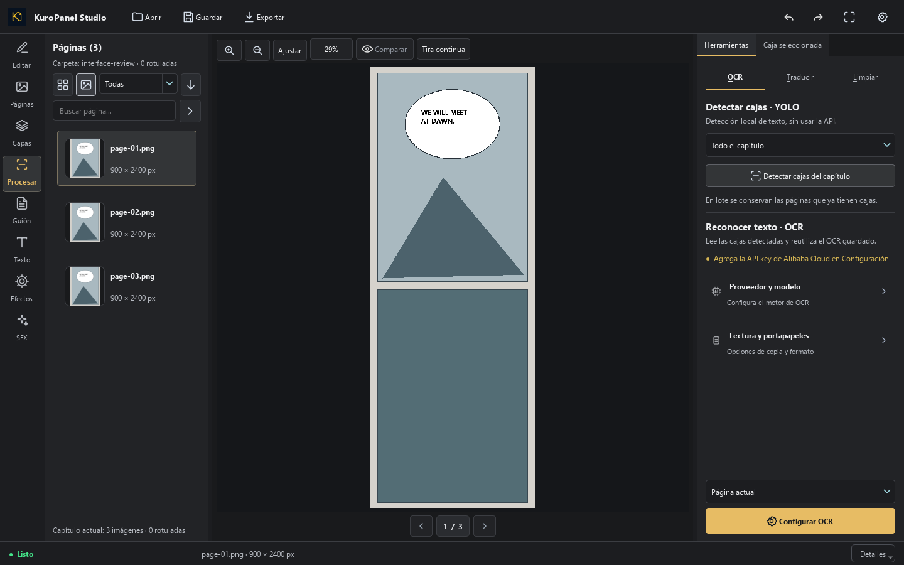

# Interfaz simplificada y detección por capítulo

En **Procesar → OCR**, la sección **Detectar cajas · YOLO** tiene un selector
independiente: **Página actual** o **Todo el capítulo**. Pulsa **Detectar cajas
del capítulo** para llenar las páginas que todavía no tienen cajas.

El lote conserva las páginas con cajas para proteger su OCR, traducción y
edición manual. Para detectar nuevamente una página, elige **Página actual**.
La detección es local y funciona sin configurar las credenciales OCR.

Para manga, abre **Procesar → OCR → Lectura y portapapeles** y activa
**Lectura manga · derecha → izquierda**. Se aplica a todo el capítulo y
se guarda con el proyecto. Cambiar la dirección renumera las cajas existentes
y conserva el texto de cada una. En cada fila, los globos pueden estar
a distinta altura y siguen leyéndose de derecha a izquierda.

Cuando hay dos grupos claramente separados por un hueco vertical, se lee
primero el grupo de la derecha. Las filas alineadas y los grupos superiores
se completan antes de bajar al siguiente grupo.

El progreso muestra la página y el porcentaje del lote. Las imágenes se
procesan en orden, una a la vez, mediante el trabajador de modelos. Cancelar
o fallar no aplica resultados parciales. Deshacer revierte el lote completo.
Si se dibujan cajas durante la detección o cambia la visibilidad de capas PSD,
se conserva ese trabajo más reciente en la página afectada.

## Dónde están los comandos

- **Abrir**: carpeta de imágenes, proyecto editable o archivo PSD/PSB.
- **Guardar**: proyecto editable. Se mantiene Ctrl+S.
- **Exportar**: página actual, capítulo en páginas o tira continua en un PNG.
  El mismo menú contiene el formato de página PNG/JPG/WEBP/PSD; la tira usa PNG.
- **Lienzo**: zoom, comparación, tira continua y anterior/siguiente.
- **Caja seleccionada**: texto y gestión de cajas. Se retiraron de aquí las
  copias de los controles de navegación, zoom, archivo y progreso.
- **Proveedor y modelo**: una fila desplegable por proceso, sin otro botón
  de configuración que abra el mismo formulario.

Se eliminaron las dos copias adicionales del botón YOLO, el aviso permanente
«Capítulo cargado» y el apartado que prometía sensibilidad/idioma/filtros pero
solo repetía el botón de detección. Los modelos y configuraciones se conservan.

La revisión incluyó ventanas de 1440 × 900 y 1060 × 740, limpieza, traducción,
inspector y estado sin capítulo. Contraste medido: texto normal 13,66:1,
secundario 8,25:1 y acción principal 9,76:1 sobre sus superficies declaradas.
Una ejecución local con el modelo YOLO real en CPU detectó texto en tres
páginas sintéticas en 1,75 s; este tiempo no representa capítulos reales.
