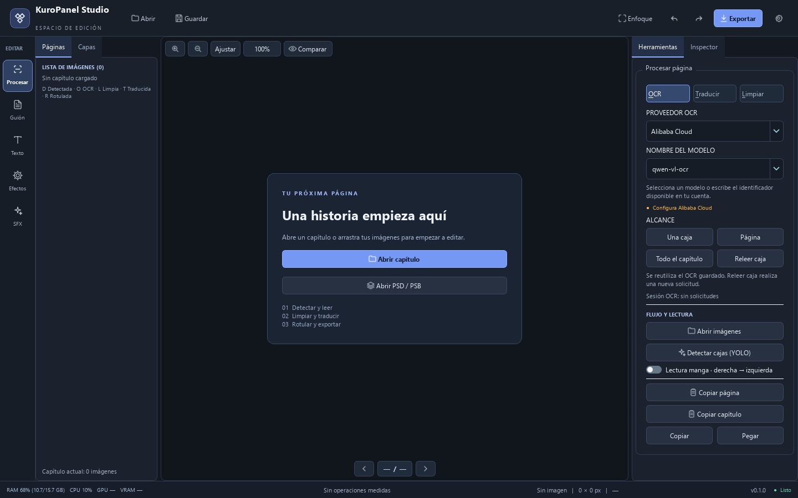

# Reducir el consumo de Alibaba OCR

## Por qué se repetían los cargos

Las acciones Página y Una caja forzaban solicitudes nuevas aun cuando el texto
ya estaba reconocido. Además, las respuestas vacías podían generar un segundo
intento automático y la caché se perdía al cerrar el editor. Una interrupción de
red también podía repetir un POST cuyo procesamiento ya hubiera comenzado.

Alibaba calcula el consumo a partir de los tokens de entrada y salida; las
imágenes también aportan tokens. La resolución de entrada y el texto enviado
influyen en ese consumo. Véase la [documentación de Qwen OCR](https://www.alibabacloud.com/help/en/model-studio/qwen-vl-ocr).

## Comportamiento actual

- **Una caja, Página y Todo el capítulo:** procesan únicamente cajas pendientes
  o modificadas. No vuelven a solicitar lecturas ya guardadas, incluso si el
  resultado revisado era vacío.
- **Releer caja:** realiza una nueva solicitud para la selección, con mejora
  local de contraste. Sirve para intentar recuperar una lectura incorrecta;
  su ayuda indica que consume una nueva solicitud.
- **Caché persistente:** hasta 10 000 lecturas en
  `%LOCALAPPDATA%/ManhuaSuiteEditor/Cache/ocr.sqlite3`. Guarda texto y claves
  hash, sin imágenes ni credenciales. Se comprueban archivo, geometría, modelo,
  servidor, estado de capas y perfil de calidad para reutilizar resultados.
- Las cajas con coordenadas idénticas comparten una solicitud, manteniendo sus
  identificadores independientes. Los resultados completados se guardan aunque
  otra llamada falle o se cancele la operación.
- No se repiten automáticamente respuestas vacías ni solicitudes interrumpidas.
  El usuario puede ejecutar de nuevo lo pendiente cuando haya revisado el fallo.
- El prompt es más corto. Se conservan los límites de resolución y los recortes
  individuales para no intercambiar diálogos entre globos.
- El panel muestra solicitudes y tokens de entrada/salida reportados durante la
  sesión. No estima dinero ni confunde datos de consumo ausentes con gasto cero.
  El contador se reinicia al cerrar el editor; no es la factura de Alibaba.



## Verificación sin gastar créditos

Los proveedores simulados cuentan cada solicitud saliente. Para 20 cajas sin
cambios, leídas tres veces:

| Escenario | Solicitudes |
| --- | ---: |
| Forzar las tres lecturas | 60 |
| Lectura inicial + repetir página + reiniciar el gestor con caché | 20 |

Eso representa **40 solicitudes evitadas (66,7%) en este caso concreto**, no una
promesa de ahorro universal en la factura. El primer OCR de una caja nueva sigue
utilizando el proveedor configurado.

La suite completa pasó con **299 pruebas y 8 subpruebas**. Trece casos nuevos
comprueban reutilización tras reinicio, invalidación al cambiar entradas,
duplicados, vacíos, relectura explícita, límites de caché, preservación de
resultados tardíos y contadores. No se realizaron llamadas reales a Alibaba
durante estas pruebas.

```powershell
python -m pytest tests/test_ocr_cost_control.py -q
```


## Recortes y contenido idéntico (8 de octubre de 2026)

Antes de codificar JPEG, se recortan solo márgenes con color uniforme comprobado
(98 % del borde). Se conserva todo píxel con diferencia de color mayor de tres
niveles y seis píxeles de contexto; la tinta tenue y la puntuación desconectada
participan en el cálculo. Un fondo texturado no se recorta. Las imágenes normales
ya no se amplían para llevar su lado menor a 128 píxeles: solo las muy pequeñas
se amplían hasta 48, con un máximo de 2×. Los límites de área y la protección de
las columnas verticales siguen vigentes.

Una segunda clave de caché combina SHA-256 del JPEG exacto, servidor, modelo,
proveedor y prompt. Permite compartir lecturas entre cajas con distinto ID o
coordenadas y entre páginas. Las peticiones simultáneas con la misma clave
esperan una sola respuesta; conservan sus IDs y el orden de entrega. El perfil
solo requiere una nueva lectura si cambia los píxeles enviados. La relectura
explícita omite esa reutilización y actualiza el resultado guardado.

Las pruebas simuladas de dos cajas idénticas y una segunda página, con reinicio
del gestor, cuentan una petición total. No se contactó con Alibaba. Reducir
píxeles puede reducir tokens de imagen, pero el proveedor aplica mínimos y reglas
según el modelo, por lo que no se afirma un porcentaje de ahorro en dinero.
`max_tokens=4096` limita salidas descontroladas; no reduce por sí solo el texto
normal generado. Una respuesta con `finish_reason=length` no se guarda ni se
reintenta automáticamente. Véase la [referencia oficial de Qwen OCR](https://www.alibabacloud.com/help/en/model-studio/qwen-vl-ocr-api-reference).


Comparación de JPEG enviados, usando los siete recortes reales anotados contra
la preparación de `HEAD` antes de estas mejoras:

| Recorte | Píxeles antes | Píxeles ahora |
| --- | ---: | ---: |
| Globo angular corto | 62 592 | 16 632 |
| Globo radial | 31 416 | 21 854 |
| Diálogo oval con línea larga | 72 000 | 96 164 |
| Total de los siete | 621 580 | 590 222 |

La línea larga recibe más resolución para conservar caracteres legibles; en
conjunto se envían 5,0 % menos píxeles en esta muestra. Los recortes con márgenes
texturados conservan su resolución. Estas cifras no son tokens facturados ni
una validación del reconocimiento remoto: no se hicieron peticiones reales.
